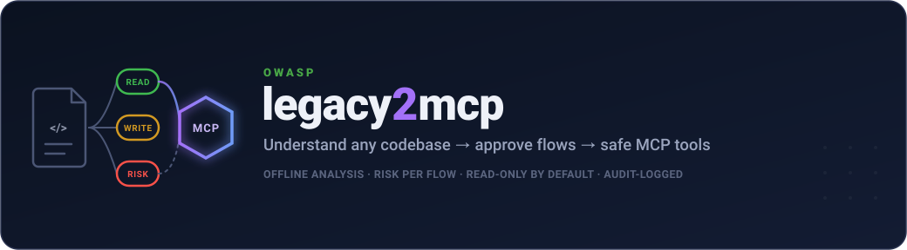
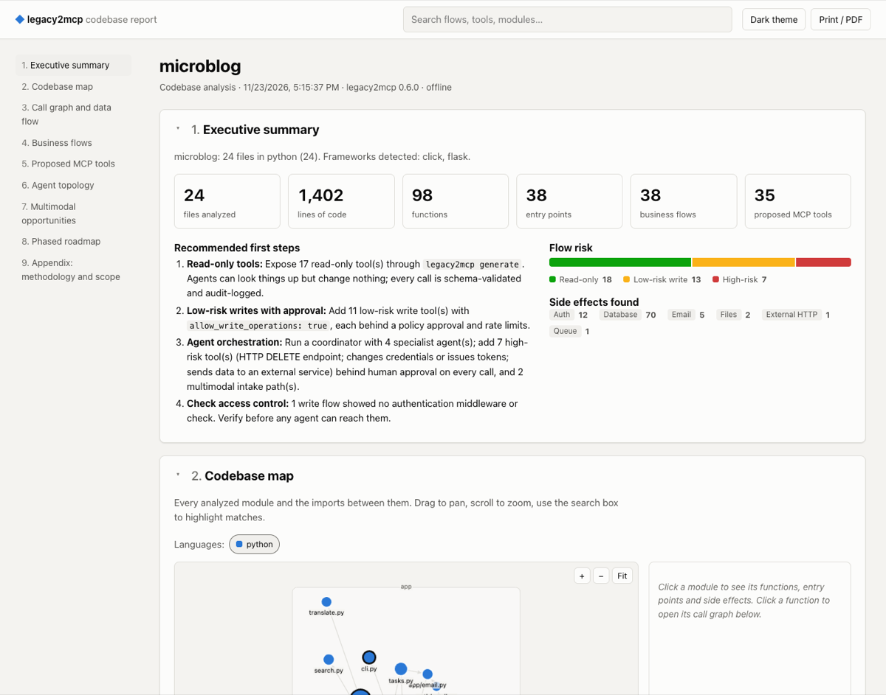
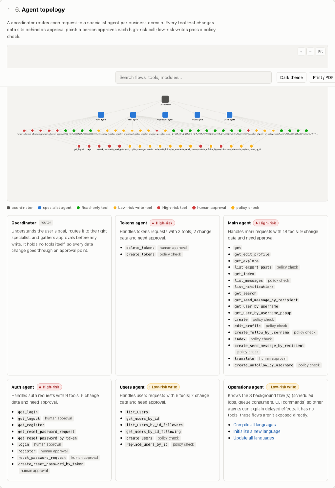

<!-- mcp-name: io.github.OWASP/legacy2mcp -->

<p align="center">
  <a href="https://owasp.org/projects/legacy2mcp">
    
  </a>
</p>

<div align="center">

# OWASP legacy2mcp

**Understand any codebase, then turn the flows you approve into a safe MCP server.**<br/>
Python and JavaScript/TypeScript. Offline, no API key, nothing executed or uploaded.

[](https://github.com/OWASP/legacy2mcp/actions/workflows/ci.yml)
[](https://pypi.org/project/legacy2mcp/)
[](https://pypi.org/project/legacy2mcp/)
[](LICENSE)
[](https://owasp.org/projects/legacy2mcp)
[](https://registry.modelcontextprotocol.io/v0.1/servers?search=io.github.OWASP/legacy2mcp)

</div>

## Quick start

You need Python 3.10+ and a local Python or JavaScript/TypeScript project.
No API key. Nothing in your project is run or uploaded.

**1. Install**

```bash
pip install "legacy2mcp[analyze]"
```

**2. Analyze your project**

```bash
legacy2mcp analyze ./my-app --no-ai
```

This creates a `legacy2mcp-analysis/` folder with `report.html` in it.

**3. Review the report**

Open `legacy2mcp-analysis/report.html` in your browser. Every business flow is
labelled **read-only**, **low-risk write** or **high-risk**, with the file and
line behind each label. Under **Proposed MCP tools**, tick the tools you want
(read-only tools are ticked for you) and click **Export selections.json**.

**4. Generate the server config**

```bash
legacy2mcp generate ./legacy2mcp-analysis \
  --selections ~/Downloads/selections.json \
  --base-url https://staging.my-app.example
```

- `--selections`: the file you exported in step 3. Leave it out to use the
  read-only tools only.
- `--base-url`: where your app is running, so the tools can call it.

This writes `config.yaml`. Write tools stay hidden unless you add `--allow-writes`.

**5. Connect it to your AI client**

Check the tools, then add this to your MCP client's config (Claude Desktop,
Cursor, VS Code, Claude Code):

```bash
legacy2mcp inspect --config config.yaml
```

```json
{
  "mcpServers": {
    "legacy2mcp": {
      "command": "legacy2mcp",
      "args": ["run", "--config", "/absolute/path/to/config.yaml"]
    }
  }
}
```

Per-client setup: [docs/clients.md](docs/clients.md).

## What the report shows

<p align="center">
  
</p>

- Every entry point (HTTP routes, CLI commands, scheduled jobs, queue
  consumers), what it calls, and its side effects: database writes, outbound
  HTTP, email, payments, queues, auth changes.
- A risk label and reasons for every flow, linked to the source line.
- The proposed MCP tools, an agent setup with approval points on every
  write, and a phased roadmap.

<p align="center">
  
</p>

See a [sample report from a real open-source app](docs/sample-report/).

## Supported frameworks

- **Python:** Flask, FastAPI, Django, click/typer, Celery, APScheduler
- **JavaScript / TypeScript:** Express, Next.js API routes, commander,
  node-cron, BullMQ, amqplib, kafkajs

Full list, AI enrichment (optional, bring your own key) and every flag:
[analyze guide](docs/analyze.md).

## Safe by default

- Nothing in the scanned repo is imported, executed or sent anywhere.
- Generated servers are read-only unless you opt in to writes.
- Every tool call is schema-validated before it reaches your backend and
  written to an audit log.
- AI enrichment is off unless you provide a key; it never changes a risk
  level or which tools are selected.

See the [security model](docs/security.md).

> [!TIP]
> Already have a SOAP service, database, REST API or website instead of a
> codebase? `legacy2mcp init` connects to it directly. See the
> [CLI guide](docs/cli.md).

## Documentation

- [Analyze guide](docs/analyze.md) · [CLI guide](docs/cli.md) ·
  [Configuration](docs/configuration.md) · [How it works](docs/how-it-works.md)
- [Clients](docs/clients.md) · [Security model](docs/security.md) ·
  [Roadmap](docs/roadmap.md) · [Changelog](CHANGELOG.md)

## Community and contributing

- **OWASP Slack:** [`#project-legacy2mcp`](https://owasp.org/slack/invite)
- **Issues:** https://github.com/OWASP/legacy2mcp/issues ·
  good starting points are labeled [`good first issue`](https://github.com/OWASP/legacy2mcp/labels/good%20first%20issue)
- **Contributing:** see [CONTRIBUTING.md](CONTRIBUTING.md) and the [Code of Conduct](CODE_OF_CONDUCT.md)
- **Security issues:** report privately per the [security policy](SECURITY.md)

## Authors & maintainers

- **[Balaji Venkatasubramaniyar](https://github.com/bvenkata)**: Project Creator and Lead Maintainer

See [AUTHORS](AUTHORS) and [MAINTAINERS.md](MAINTAINERS.md).

## How to cite

Use GitHub's "Cite this repository" button ([CITATION.cff](CITATION.cff)), or:

```bibtex
@software{legacy2mcp,
  author  = {Venkatasubramaniyar, Balaji},
  title   = {OWASP legacy2mcp: Safe, Typed, Audit-Logged MCP Servers for Legacy Systems},
  url     = {https://github.com/OWASP/legacy2mcp},
  license = {Apache-2.0}
}
```

## License

Apache 2.0. See [LICENSE](LICENSE).

<div align="center"><sub>OWASP legacy2mcp · an <a href="https://owasp.org/projects/legacy2mcp">OWASP Foundation</a> project</sub></div>
