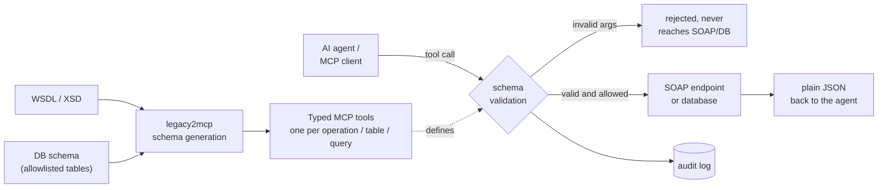

<!-- mcp-name: io.github.bvenkata/legacy2mcp -->

# legacy2mcp

<div align="center">


<p>
  <a href="https://github.com/bvenkata/legacy2mcp/actions/workflows/ci.yml"></a>
  <a href="https://pypi.org/project/legacy2mcp/"></a>
  <a href="https://pypi.org/project/legacy2mcp/"></a>
  <a href="https://registry.modelcontextprotocol.io/v0.1/servers?search=io.github.bvenkata/legacy2mcp"></a>
  <a href="https://glama.ai/mcp/servers/bvenkata/legacy2mcp"></a>
  <a href="LICENSE"></a>
</p>

<p>
  <a href="https://github.com/bvenkata/legacy2mcp/stargazers"></a>
  <a href="https://github.com/bvenkata/legacy2mcp/network/members"></a>
  <a href="https://github.com/bvenkata/legacy2mcp/graphs/contributors"></a>
  <a href="https://github.com/bvenkata/legacy2mcp/commits/main/"></a>
  <a href="https://pypi.org/project/legacy2mcp/"></a>
</p>

<p>
  <a href="#client-claude-desktop"></a>
  <a href="#client-cursor"></a>
  <a href="#client-vs-code"></a>
  <a href="#client-claude-code"></a>
  <a href="#client-mcp-inspector"></a>
</p>

## Convert anything to MCP in 60 seconds. Read-only by default, with every call audit-logged.

</div>

---

## Quick start

No API key, no cloning — pick whichever matches what you actually have,
against live public demo targets:

```bash
pip install legacy2mcp

# REST API -- tries OpenAPI/Swagger discovery
legacy2mcp init --rest-url "https://petstore3.swagger.io/api/v3"

# WSDL / SOAP service -- zeep introspects it live, no scan needed
legacy2mcp init --wsdl-url "http://www.dneonline.com/calculator.asmx?WSDL"

# A website with no API docs at all -- crawls it for forms/content
legacy2mcp init --webpage-url "https://legacy2mcp.com/"
```

Run any one of those from a real terminal and that's the whole thing: it
writes `config.yaml`, opens a local test-chat page with a clickable example
question under every discovered tool — click one and see a real response
come back from the live source, no AI key needed, just local keyword
matching to sanity-check the server works — and prints a ready-to-paste
connection snippet for Claude Desktop, Cursor, VS Code, and Claude Code.
Wiring it into a real AI client is a copy-paste, not a separate step.
(Prefer the raw tool list instead? `legacy2mcp inspect --config config.yaml`.)

[`legacy2mcp discover`](#discover-a-legacy-interface-before-generating-a-server)
does the same for sources that benefit from a review step first (a
Postman collection, a HAR capture, …): write a contract, open the same
test chat, print the same connection snippet — one command either way.

Have your own WSDL, REST API, website, or codebase instead? `legacy2mcp
init` (no flags) walks you through it — see
[Generate a config automatically](#generate-a-config-automatically). More
demos (a local SOAP service, Docker, a WSDL served by raw URL) are listed in
[examples/](examples/README.md).

> [!NOTE]
> `legacy2mcp` introspects your legacy system live — every WSDL operation, every database table, every REST spec it can find — and builds a real JSON Schema for each tool from it. Every [MCP](https://modelcontextprotocol.io/) tool call is **schema-validated before it reaches your backend**, **write operations are excluded by default**, and **every call is audit-logged**. No hand-written adapter code, no hand-maintained schemas, no arbitrary SQL from the LLM.

## Contents

- [Install](#install)
- [Quick start](#quick-start)
- [How it works](#how-it-works)
- [Why not just write an adapter by hand?](#why-not-just-write-an-adapter-by-hand)
- [Point it at your own WSDL](#point-it-at-your-own-wsdl)
- [Point it at your own database](#point-it-at-your-own-database)
- [Point it at your own REST API](#point-it-at-your-own-rest-api)
- [Generate a config automatically](#generate-a-config-automatically)
- [Discover a legacy interface before generating a server](#discover-a-legacy-interface-before-generating-a-server)
- [Teach your AI coding agent about legacy2mcp](#teach-your-ai-coding-agent-about-legacy2mcp)
- [Common commands](#common-commands)
- [Client support](#client-support)
- [What's handled](#whats-handled)
- [Safety model](#safety-model)
- [Data flow and privacy](#data-flow-and-privacy)
- [Use cases](#use-cases)
- [Real-world usage](#real-world-usage)
- [Configuration reference](#configuration-reference)
- [Documentation](#documentation)
- [Roadmap](#roadmap)
- [Development](#development) · [Contributing](#contributing) · [License](#license)

## Install

```bash
# Full install (recommended)
pip install "legacy2mcp[ai]"

# Or the identical, scan-only-ready core -- AI-assisted `legacy2mcp init`
# needs no extra package either way, just an API key at runtime; `[ai]`
# above installs nothing extra today, it's just a stable, familiar name
pip install legacy2mcp
# or:  uv tool install legacy2mcp   ·   pipx install legacy2mcp
```

Also published to the **[MCP Registry](https://registry.modelcontextprotocol.io/v0.1/servers?search=io.github.bvenkata/legacy2mcp)** as `io.github.bvenkata/legacy2mcp`, so registry-aware MCP clients can discover it directly.

## How it works



**SOAP:**
1. Loads the WSDL with [`zeep`](https://docs.python-zeep.org/), a mature, widely-used Python SOAP client.
2. For every operation on every port/binding, converts the XSD input type into a JSON Schema ([`schema/xsd_to_jsonschema.py`](src/legacy2mcp/schema/xsd_to_jsonschema.py)) — simple types, nested complex types, enums and arrays, recursively, depth-limited for pathological WSDLs.
3. Registers one MCP tool per operation, named `<adapter_id>_<OperationName>`.
4. On a tool call: validates arguments with `jsonschema` (schemas use `additionalProperties: false`), calls the operation via `zeep`, serializes the response to plain JSON, and writes an audit entry.

**DB:**
1. Connects with the dialect's driver (`psycopg` / `pyodbc` / `oracledb`, imported lazily) and introspects the live column types for each allowlisted table ([`adapters/db_dialects.py`](src/legacy2mcp/adapters/db_dialects.py)) into JSON Schema ([`schema/sql_to_jsonschema.py`](src/legacy2mcp/schema/sql_to_jsonschema.py)).
2. Registers `select_<table>` / `insert_<table>` per allowlisted table-and-operation, plus `query_<name>` per named query in config.
3. On a tool call: validates arguments, builds SQL from the allowlisted table/columns (or runs the config-supplied named query) using one dialect-neutral `:param` placeholder convention, executes it, and writes an audit entry. The LLM never sees or writes SQL text.
4. Operations whose names look like writes are excluded unless `allow_write_operations: true`.

**REST:**
1. There's no live schema to introspect a plain REST API from the way there is a WSDL or a DB catalog, so the endpoint list (method, path, typed params) comes from config -- hand-written, or generated by `legacy2mcp init`'s OpenAPI/Swagger discovery or source-code scan.
2. Registers one MCP tool per allowlisted endpoint, named `<adapter_id>_<name>`.
3. On a tool call: validates arguments, splits them into path/query/body by each param's declared `location`, substitutes `{param}` placeholders into the URL, and calls it with `requests` -- auth applied per the adapter's `auth` config (basic/bearer/none).
4. Endpoints marked `write: true` (non-`GET` by default) are excluded unless `allow_write_operations: true`.

## Why not just write an adapter by hand?

Because a hand-written adapter is a second copy of your system's schema that
nobody remembers to update. The first time a WSDL operation's signature
shifts or a column changes, your tool's JSON Schema silently drifts from
reality — and an LLM calling it finds out by sending arguments that are
wrong in a way nothing catches, or by getting a confusing runtime error from
deep inside the SOAP/DB client. legacy2mcp builds the schema from the live
system every time it starts, so a drifted call fails at validation, before
it ever reaches your backend — not after.

| | Hand-written adapter (FastMCP / raw SDK) | Generic OpenAPI-to-MCP proxy | legacy2mcp |
|---|---|---|---|
| Schema source | Typed by hand, per tool | The OpenAPI spec, if one exists | The live WSDL / DB schema, or a discovered OpenAPI spec |
| Can drift from the real system | Yes — nothing re-checks it | Only if the spec itself is stale | No — rebuilt from the live source at startup |
| Covers SOAP / a database | You write that client code yourself | No — REST/OpenAPI only | Yes, plus REST and plain websites |
| Write operations hidden by default | No — you remember to gate each one | No — usually exposes everything the spec defines | Yes — explicit `allow_write_operations` opt-in |
| Audit log of every call | DIY | Usually no | Built in |
| Time to a working server | Hours to days, per system | Minutes, for a REST API with a spec | Minutes — `legacy2mcp init` |

## Point it at your own WSDL

```yaml
# config.yaml
server:
  name: my-legacy-mcp

adapters:
  - id: legacy
    type: soap
    config:
      wsdl_url: "https://service.example.com/LegacyService?wsdl"
      auth:
        type: basic
        username: "svc-account"
        password_env: "SERVICE_PASSWORD"   # value read from the environment, never the file
      allow_write_operations: false        # Create*/Update*/Delete*/… stay hidden
      include_operations: ["GetRecord", "GetRecordDetails", "SearchRecords"]

security:
  audit:
    enabled: true
    path: "./legacy-mcp-audit.log"
```

```bash
export SERVICE_PASSWORD=...
legacy2mcp inspect --config config.yaml   # review the generated tools
legacy2mcp run     --config config.yaml   # start the MCP server (stdio)
```

A production-shaped template with comments lives at [`examples/soap/config.template.yaml`](examples/soap/config.template.yaml).

## Point it at your own database

```bash
pip install "legacy2mcp[db-postgres]"   # or db-mssql / db-oracle
```

```yaml
# config.yaml
adapters:
  - id: orders
    type: db
    config:
      dialect: postgres             # postgres | mssql | oracle
      dsn_env: "ORDERS_DB_DSN"      # connection string, read from the environment
      allow_write_operations: false # insert_<table> / write: true queries stay hidden
      tables:
        - name: orders
          operations: [select]
          columns: [id, status, total, created_at]   # column allowlist
          filterable_columns: [status]                # equality filters on select_orders
          max_rows: 200
      queries:
        - name: orders_by_status_since
          sql: "SELECT id, status, total FROM orders WHERE status = :status AND created_at >= :since"
          params:
            - { name: status, type: string, required: true }
            - { name: since, type: string, required: true }
```

```bash
export ORDERS_DB_DSN=...
legacy2mcp inspect --config config.yaml   # review the generated tools
```

Columns are introspected from the live schema at startup, the same way SOAP operation
schemas come from the WSDL -- there's nothing to hand-maintain. **There is no path from
the LLM to arbitrary SQL, ever**: it can only call `select_<table>` / `insert_<table>` for
tables listed under `tables:`, or a `query_<name>` tool whose SQL you wrote under
`queries:` -- the LLM supplies only the placeholder values a query's `params` declare,
never SQL text. A production-shaped template lives at
[`examples/db/config.template.yaml`](examples/db/config.template.yaml).

## Point it at your own REST API

There's no WSDL or live database schema to introspect a plain REST/JSON API
from, so the `rest` adapter's endpoint list is explicit config -- write it
by hand, or generate a starting point with `legacy2mcp init` (next
section).

```yaml
# config.yaml
adapters:
  - id: orders
    type: rest
    config:
      base_url: "https://api.example.com"
      auth:
        type: bearer
        token_env: "ORDERS_API_TOKEN"
      allow_write_operations: false
      endpoints:
        - name: get_order
          method: GET
          path: "/orders/{order_id}"
          params:
            - { name: order_id, location: path, type: integer, required: true }
        - name: create_order
          method: POST
          path: "/orders"
          write: true   # stays hidden unless allow_write_operations: true
          params:
            - { name: total, location: body, type: number, required: true }
```

A production-shaped template lives at
[`examples/rest/config.template.yaml`](examples/rest/config.template.yaml).

> [!NOTE]
> Both a non-`GET` method and an LLM-assisted classification are
> heuristics, not a guarantee the endpoint is actually safe to call
> unsupervised -- review `write:` flags and `allow_write_operations` before
> running against a real backend, same caveat as the SOAP adapter's
> write-verb heuristic below.

## Generate a config automatically

`legacy2mcp init` asks what to point it at, then writes a starting
`config.yaml` for you:

```bash
legacy2mcp init
```

```
What do you want to point legacy2mcp at?
  1) WSDL URL (SOAP service)
  2) REST API URL (tries OpenAPI/Swagger discovery)
  3) A website with no API docs at all (crawls it for forms/content)
  4) GitHub repo URL or a local path to its source code
Choice [1-4]:
```

| Option | What happens | Needs an LLM key? |
|---|---|---|
| **WSDL URL** | Points a `soap` adapter at it directly -- `zeep` introspects the live WSDL at `inspect`/`run` time anyway, so nothing needs scanning up front. | No |
| **REST API URL** | Tries the common OpenAPI/Swagger spec locations (`/openapi.json`, `/swagger.json`, ...) against that URL and builds the `rest` adapter's endpoint list from the real spec if one's found; an empty scaffold otherwise. | No |
| **Website** | Crawls same-site pages starting there (`--max-pages`/`--max-depth` bound it, default 25/2) the same way `legacy2mcp discover --webpage-url` does, then goes straight to a config instead of stopping at a `contract.yaml` -- every operation still lands at `confidence: low` / `needs_review: true` in the generated TODOs, going through `init` skips a file, not the review. | No |
| **GitHub repo / local path** | Clones (or reads) the repo and statically scans its Python source (AST only, never executed) for a `zeep.Client(...)` call, a SQLAlchemy/Flask-SQLAlchemy model, or Flask/FastAPI routes -- picking `soap`/`db`/`rest` accordingly. | Optional |

Each also works non-interactively via a flag -- `--wsdl-url`, `--rest-url`,
`--webpage-url`, `--github-url`, or `--local-path` -- for scripting or CI.
Only the GitHub/source-code path can use an LLM, and only to refine what
static analysis already found (ambiguous parameter types, read-vs-write
classification) -- never a dump of your repo. It needs no extra
dependency, just an OpenAI-compatible API key via `--llm-api-key-env`, or
an interactive hidden prompt if you omit that (never written to disk);
pass `--scan-only` to skip it outright and run static-analysis-only, same
as not entering a key.

```bash
legacy2mcp init --github-url https://github.com/you/your-api --scan-only --out config.yaml
```

Whichever path you take, review the generated file before running it --
it's marked up with `# TODO` comments for anything that couldn't be
confidently inferred (an unresolved `base_url`, an unverified param type,
which endpoints got classified `write: true`), and nothing in it is
verified against the real backend until you do:

```bash
legacy2mcp inspect --config config.yaml   # review the generated tools
legacy2mcp run     --config config.yaml   # start the MCP server
```

`legacy2mcp init` also writes a plain-English HTML report next to the
config (e.g. `config.yaml` -> `config.html`) -- open it in a browser to see,
in sentences rather than YAML, what tools the server will expose (every
REST endpoint / DB table / SOAP target it found, which ones can change data
and are gated behind `allow_write_operations`, and the review items above).
Pass `--html-out` to change where it's written, or `--no-html-report` to
skip it.

**Run `init` from a real terminal against a config that's already usable**
(a live `--wsdl-url`/`--rest-url`, or a scan that found something concrete)
**and it also opens a local test-chat page** in your browser, with a
clickable example question under every discovered tool (generated from
that tool's own name and schema, e.g. `getPetById` -> "get pet by id 4") so
you don't have to guess what to type. Click one, or type your own, and it
matches it to a discovered tool, calls the real adapter, and shows you the
real response. No AI/API key needed for this -- it's local keyword
matching against the tool names/descriptions, not an LLM, just enough to
sanity-check that the server actually works before you wire up a real MCP
client. It's skipped automatically when the config still has TODOs to fill
in (nothing to connect to yet), and never opens at all in
non-interactive/scripted runs. Pass `--no-chat` to opt out.

See [docs/security.md](docs/security.md) for exactly what this heuristic
does and doesn't guarantee before pointing it at anything real.

## Discover a legacy interface before generating a server

`init` covers a live WSDL, a live REST URL, a website (`--webpage-url`),
and a repo it can scan -- all of those go straight to a config, no
separate step needed. For everything else -- a Postman collection someone
already built, an OpenAPI spec file sitting in a repo with no server
running yet, a database's stored-procedure catalog, a HAR capture of real
traffic, or queues you already know about -- there's an explicit step
first:

```bash
legacy2mcp discover --postman-file my-collection.json --out contract.yaml
legacy2mcp discover --openapi-file spec.yaml --out contract.yaml
legacy2mcp discover --har-file traffic.har --out contract.yaml
legacy2mcp discover --stored-procs --db-dialect postgres --db-dsn-env LEGACY_DB_DSN --out contract.yaml
legacy2mcp discover --queue-config queues.yaml --out contract.yaml
```

A website *can* go through `discover --webpage-url` too (see below) if you
want to review the contract before anything gets built -- `init
--webpage-url` runs the identical crawl, it just doesn't pause there.

Each writes a **Legacy Interface Contract** (`contract.yaml`): every
operation's inputs, outputs, enums, error codes, whether it reads or
writes, and a **confidence level** -- `high` for a live schema/catalog,
`medium` for a curated artifact like a Postman collection, `low` for
anything inferred from sampled traffic -- plus `needs_review` flags and
notes on anything uncertain. Review it like you'd review `config.yaml`'s
`# TODO`s.

Run that same command from a real terminal, though, and `discover` doesn't
stop at the contract: if the contract has anything invocable in it (not
every source does yet -- see below), it also writes a runnable
`config.yaml`, opens the same no-API-key test-chat page `init` can
auto-launch, and prints the same ready-to-paste MCP client JSON --
discover, try it, and get the connection snippet, in the one command you
already ran. Pass `--no-chat` to skip that and just get the contract (the
default in non-interactive/CI runs already), or `--no-write-config` to skip
only the `config.yaml` write.

Prefer to review the contract first before anything gets built or run? Skip
straight to either step yourself instead:

```bash
legacy2mcp init --from-contract contract.yaml --out config.yaml
legacy2mcp demo --from-contract contract.yaml
```

`demo` is the same "try it" step `discover` can auto-launch, just callable
on its own (also works from an existing `--config config.yaml`, not only a
contract) -- it saves a standalone `chat.html` pointing at the server it
just started (opened automatically unless `--no-open`), and prints the
client JSON once a config exists to point it at. The command has to keep
running (`Ctrl+C` to stop) for that page to work; it's a thin client page
with no backend of its own, so the real HTTP calls still have to be made by
*something*, same reason the browser can't just open a config file and
call a REST API directly.

A few things worth knowing:

- **No raw secret is ever written into a contract.** A Postman collection's
  saved bearer token, a HAR capture's `Authorization`/`Cookie` header
  values -- none of it gets persisted; only a note that auth was present,
  for you to configure yourself. The one controlled exception is a small,
  non-sensitive-looking **enum** (e.g. a `status` field that only ever took
  a handful of values across enough samples to mean something) -- see
  [docs/security.md](docs/security.md).
- **For `--har-file`**, legacy2mcp never drives a capture proxy itself --
  point it at a HAR produced by anything: your browser devtools' "Export
  HAR", Postman's own traffic capture, or mitmproxy's built-in exporter
  (`mitmdump --set hardump=out.har`, or "Export as HAR" in the GUI). This
  is the lowest-confidence source (inferred from whatever was sampled, not
  a declared contract) -- every operation comes back flagged for review.
- **`--webpage-url`** is for a legacy web app or content site with no API
  docs at all -- just a URL. It crawls same-site pages from there
  (`--max-pages`/`--max-depth` bound it, default 25 pages / depth 2,
  never leaving the starting host), turning every `<form>` into an
  operation (a `<select>`'s options, or a shared-name radio/checkbox
  group, become an `enum`) and every form-less page with real content
  into a read-only "get this page" tool. No JavaScript is executed and
  nothing is ever submitted; non-GET forms get a note to confirm the
  backend accepts a JSON body (the REST adapter always sends one, even
  though a real browser would POST `application/x-www-form-urlencoded`).
  Same lowest-confidence posture as `--har-file` -- but unlike every
  other `discover` source, `base_url` fills in automatically (it's the
  host just fetched), so the test-chat page opens right away. Full crawl
  mechanics: [docs/security.md](docs/security.md).
- **Stored procedures and queue descriptions are documented, not runnable
  yet.** `--stored-procs` and `--queue-config` still produce real contract
  entries -- there's no adapter to actually *call* either today (see
  [docs/roadmap.md](docs/roadmap.md)), so `init --from-contract` skips them
  with a clear TODO rather than pretending they work. Same reason
  `discover`'s auto-demo (above) has nothing to launch for a contract made
  up only of those -- it says so and just exits with the contract already
  written, rather than failing the whole command.
- **Every generated server also gets a `describe_capabilities` tool** for
  free -- a connected agent can call it to ask "what can this system do?"
  (every tool's description, side effect, confidence, required fields,
  known error codes) before calling anything for real.
- **`--out contract.html`** writes a human-readable report instead of the
  plain YAML -- the same operations, as a table, in your browser. It's
  still a valid `--from-contract`/`demo --from-contract` input: the full
  contract is embedded in the page (in a `<script type="application/json">`
  tag), not just summarized for reading.

## Teach your AI coding agent about legacy2mcp

The sections above are about the MCP servers `legacy2mcp` *produces*. This
one is different: it's for when an AI coding agent (Claude Code, Cursor,
Codex CLI, Gemini CLI, GitHub Copilot, ...) is helping you *build* the
integration in the first place, and you want it to already know how.

```bash
legacy2mcp install-skill
```

This writes short, command-first legacy2mcp instructions directly into the
current repo's own agent context files — a Claude Code slash command
(`.claude/commands/legacy2mcp.md`), a Cursor rule
(`.cursor/rules/legacy2mcp.mdc`), and a `## legacy2mcp` section appended (or
updated in place) in `AGENTS.md`, `GEMINI.md`, and
`.github/copilot-instructions.md`. The agent then already knows the core
workflow — which `init` flag fits which source, review the `# TODO`s before
trusting a generated config, check `inspect` before running anything live —
without you re-explaining it every session. It's idempotent: re-running it
replaces its own section rather than duplicating it, so it's safe to run
again after an upgrade. Review what it writes and commit it so your whole
team gets the same instructions (this repo does exactly that — see
[AGENTS.md](AGENTS.md)).

There's also a standalone [`SKILL.md`](skill/legacy2mcp/) in this repo,
written to the open [Agent Skills standard](https://www.agensi.io/learn/what-is-skill-md)
— the same know-how in a form marketplaces like [Agensi](https://www.agensi.io)
can list independently of any particular repo, for agents that discover
skills that way instead.

## Common commands

```bash
# Print the installed legacy2mcp version
legacy2mcp --version

# Generate a config from a live REST API (tries OpenAPI/Swagger discovery)
legacy2mcp init --rest-url "https://api.example.com" --out config.yaml

# Generate a config from a WSDL URL directly -- no scan needed
legacy2mcp init --wsdl-url "https://service.example.com/Legacy?wsdl" --out config.yaml

# Generate a config from a website with no API docs at all -- crawls it
legacy2mcp init --webpage-url "https://your-legacy-app.example.com" --out config.yaml

# Generate a config by statically scanning a GitHub repo (no AI, no API key)
legacy2mcp init --github-url https://github.com/you/your-api --scan-only --out config.yaml

# Same, with AI-assisted refinement of ambiguous parameter types / read-vs-write
legacy2mcp init --github-url https://github.com/you/your-api --llm-api-key-env OPENAI_API_KEY --out config.yaml

# Review a source before generating anything -- a Postman collection, OpenAPI
# file, HAR capture, stored-procedure catalog, or queue description
legacy2mcp discover --postman-file my-collection.json --out contract.yaml

# Try a config or contract in a chat page right now, no separate init step
legacy2mcp demo --from-contract contract.yaml
legacy2mcp demo --config config.yaml

# Review the tools a config generates -- no server started
legacy2mcp inspect --config config.yaml

# Print the tool list as JSON, for scripting or a CI diff check
legacy2mcp inspect --config config.yaml > tools.json

# Start the MCP server (stdio)
legacy2mcp run --config config.yaml

# Teach the AI coding agent working in *this* repo how to drive legacy2mcp
# (see "Teach your AI coding agent about legacy2mcp" above)
legacy2mcp install-skill
```

## Client support

[](#client-claude-desktop)
[](#client-cursor)
[](#client-vs-code)
[](#client-claude-code)
[](#client-mcp-inspector)
[](https://github.com/bvenkata/legacy2mcp/actions/workflows/mcp-compatibility.yml)

"Verified" here means a specific, narrow thing: the exact command + config
shape shown below was actually spawned and completed a real MCP
`initialize` handshake over stdio -- not just "MCP should be compatible."
For MCP Inspector, the loop was driven further: a real `tools/list`, a real
`tools/call`, and the resulting [audit log](#safety-model) entry, all
headlessly via the Inspector's own `--cli` mode. The last badge is what
keeps that claim honest over time rather than a one-time snapshot: a CI job
([`mcp-compatibility.yml`](.github/workflows/mcp-compatibility.yml)) re-runs
that same `tools/list` / `tools/call` / audit-log loop on every push and
fails the build if the server can't start or exposes the wrong tools. Every
client below talks to `legacy2mcp` over **stdio only** -- there's no
HTTP/SSE transport yet (it's on the [roadmap](docs/roadmap.md), not
shipped), so an `http://localhost:...` MCP URL won't work here.

| Client | Status | How it was verified |
|---|---|---|
| Claude Desktop | Verified | Spawned the exact `claude_desktop_config.json` command, completed a real `initialize` handshake, confirmed tools listed |
| Cursor | Verified | Same, via `.cursor/mcp.json`'s exact command |
| VS Code | Verified | Same, via `.vscode/mcp.json`'s exact command |
| Claude Code | Documented | Uses the identical launch command verified above via `claude mcp add`; that command itself wasn't independently re-run in this environment |
| MCP Inspector | Tested | Full CLI loop -- `tools/list`, `tools/call`, and the audit log entry it produced |

This repo also ships the checked-in configs themselves --
[`.mcp.json`](.mcp.json), [`.cursor/mcp.json`](.cursor/mcp.json), and
[`.vscode/mcp.json`](.vscode/mcp.json) -- pointed at the bundled Petstore
demo, so opening this repo in one of these tools gets you a working server
with no setup. Copy whichever matches your tool into your own project and
point `--config` at your own `config.yaml`.

<details id="client-claude-desktop">
<summary><b>Claude Desktop</b> — <code>claude_desktop_config.json</code></summary>

macOS: `~/Library/Application Support/Claude/claude_desktop_config.json`
Windows: `%APPDATA%\Claude\claude_desktop_config.json`

```json
{
  "mcpServers": {
    "legacy2mcp": {
      "command": "uvx",
      "args": ["legacy2mcp", "run", "--config", "/absolute/path/to/config.yaml"]
    }
  }
}
```

If you installed with `pip`/`pipx` instead of `uv`, use `"command": "legacy2mcp"` and drop the
first element of `args`.

</details>

<details id="client-cursor">
<summary><b>Cursor</b> — <code>.cursor/mcp.json</code></summary>

Project-local (`.cursor/mcp.json`) or global (`~/.cursor/mcp.json`):

```json
{
  "mcpServers": {
    "legacy2mcp": {
      "command": "uvx",
      "args": ["legacy2mcp", "run", "--config", "/absolute/path/to/config.yaml"]
    }
  }
}
```

</details>

<details id="client-vs-code">
<summary><b>VS Code</b> — <code>.vscode/mcp.json</code></summary>

```json
{
  "servers": {
    "legacy2mcp": {
      "type": "stdio",
      "command": "uvx",
      "args": ["legacy2mcp", "run", "--config", "/absolute/path/to/config.yaml"]
    }
  }
}
```

</details>

<details id="client-claude-code">
<summary><b>Claude Code</b> — CLI</summary>

```bash
claude mcp add legacy2mcp -- uvx legacy2mcp run --config /absolute/path/to/config.yaml
```

Add `--scope project` to write a shared `.mcp.json` for your team (keep secrets out of it);
check with `claude mcp list`.

</details>

<details id="client-mcp-inspector">
<summary><b>MCP Inspector</b> — a validation tool, not an AI client</summary>

```bash
npx @modelcontextprotocol/inspector uvx legacy2mcp run --config /absolute/path/to/config.yaml
```

Opens a local web UI: connect to the server, confirm tools are listed, run one read-only tool,
and check `legacy2mcp-audit.log` for the matching entry. That exact loop -- tool discovery, one
real call, the audit log it produces -- is what the "Tested with MCP Inspector" badge above
is actually backed by, driven headlessly through the Inspector's own `--cli` mode rather than
just opened in a browser.

</details>

Passing secrets and troubleshooting: [docs/clients.md](docs/clients.md).

## What's handled

| Area | Covered |
|---|---|
| **Type mapping** | `string` / `int` / `long` / `decimal` / `boolean` / `date` / `dateTime` / `base64Binary` / … → JSON Schema types + formats |
| **Structure** | nested complex types, repeated elements → arrays, `xsd:enumeration` → `enum`, recursion depth-limited |
| **Discovery** | every service → port → binding → operation; duplicate tool names rejected at startup |
| **Invocation** | argument validation, `zeep` call, response serialized to plain JSON, single-field responses re-wrapped to a named result |
| **Errors** | SOAP faults and transport errors caught and returned as clean messages — no stack traces to the caller |
| **Auth** | HTTP basic (username + `*_env` password); bearer token (`*_env`); anonymous |
| **Transport** | `stdio` (the transport Claude Desktop and most agent frameworks spawn) |
| **DB dialects** | Postgres, SQL Server, Oracle — table allowlist (`select`/`insert`) with live schema introspection, plus named parameterized queries |
| **REST** | explicit endpoint allowlist (method + path + typed params) from config or `legacy2mcp init` — no live schema to introspect, so nothing here is verified until you run it |
| **Discover sources** | Postman collections, local OpenAPI/Swagger files, a live DB's stored-procedure catalog, HAR traffic captures, declarative queue descriptions, and websites (`--webpage-url`, crawled for forms/content) → a reviewable `contract.yaml` (confidence, enums, error codes) → `legacy2mcp init --from-contract` or straight into `init --webpage-url`/`demo` |
| **`describe_capabilities`** | every generated server exposes this meta-tool for free — an agent can ask what the server can do before calling anything |
| **Try it + connect** | `init`/`discover`/`demo` all auto-open a no-API-key test-chat page and print a ready-to-paste connection snippet for Claude Desktop, Cursor, VS Code, and Claude Code |

See [docs/security.md](docs/security.md) for the full, honest security model — what's covered today and what isn't yet.

## Safety model

| Layer | What it does |
|---|---|
| **Schema validation** | No arguments reach the SOAP/DB layer without passing `jsonschema.validate` against that tool's generated schema. |
| **Read-only by default** | SOAP: operation names are matched against write-verb prefixes (`Create`, `Update`, `Delete`, `Cancel`, `Void`, `Submit`, `Pay`, …). DB: tables/queries are explicit opt-in, and `insert`/write-marked queries additionally require it. Neither is exposed unless you set `allow_write_operations: true`. |
| **Explicit allow / deny** | SOAP: `include_operations` / `exclude_operations`. DB: a table/column allowlist — there's no equivalent of "all tables" or arbitrary SQL. |
| **Audit log** | One JSON line per call — tool, arguments, timestamp, outcome, duration. |
| **Secret hygiene** | Credentials and DB connection strings come from named environment variables; the YAML stays safe to commit. |

> [!WARNING]
> The SOAP write-operation filter is a **name heuristic, not semantic analysis** — an operation called `ProcessRecord` that deletes data would not be caught. For any system where a wrong call has real consequences, set `include_operations` explicitly and don't rely on the heuristic. The DB adapter's allowlist is explicit by construction, but **there's no column-level data masking** — an allowlisted column's values are always returned as-is. There is also no auth/authz on the MCP server itself yet — don't expose a server to untrusted callers. Details in [docs/security.md](docs/security.md).

## Data flow and privacy

- **No telemetry.** legacy2mcp collects no usage data and phones home to nothing. Every network call it makes is one you configured it to make — verified by checking every outbound HTTP call site in the source before writing this sentence.
- **Adapter calls go exactly where you pointed them, nowhere else.** SOAP calls go to your `wsdl_url`, DB calls go to your `dsn_env` connection, REST calls go to your `base_url`.
- **`legacy2mcp init`'s discovery calls are scoped to what you gave it.** The WSDL and REST(OpenAPI) paths only ever contact the URL you passed. The GitHub/source-code path clones the repo you specify and parses it locally with `ast` — nothing from it is ever executed.
- **The optional LLM-assist step sends only already-detected, ambiguous fragments — never your repo.** It only runs on the GitHub/source-code path of `legacy2mcp init`, only if you provide an API key, and only sends the specific route names/paths/params the static scan already flagged as ambiguous, not a dump of your source. Skip it entirely with `--scan-only`.
- **`legacy2mcp discover` reads local files, except `--stored-procs`.** Postman/OpenAPI/HAR/queue sources never touch the network — they read a file you gave it. `--stored-procs` connects to the DSN in the env var you named, the same way the `db` adapter does, only to read the procedure/function catalog. No raw secret or sampled value is ever written into the resulting `contract.yaml` — see [docs/security.md](docs/security.md).
- **Secrets never live in `config.yaml`.** Passwords, DSNs, and API tokens are all referenced by environment-variable name (`password_env`, `dsn_env`, `token_env`) and read at runtime — the YAML stays safe to commit.
- **The audit log stays local and is not encrypted at rest.** Every tool call is appended as one JSON line to `security.audit.path`. Arguments are logged as-is — there's no PII redaction; see [docs/security.md](docs/security.md) for the full list of what the audit log does and doesn't do.

## Use cases

| Domain | Shape |
|---|---|
| **Systems of record** | An agent reads status/detail records from a legacy back-office platform, read-only, every lookup logged. |
| **Financial services** | Expose account and transaction *reads* without exposing transfers or adjustments. |
| **Supply chain / ERP** | Surface order status, inventory, shipment tracking from an old SOAP middleware layer. |
| **Internal support tooling** | A support copilot gets safe, typed access to the system of record instead of a scraped UI. |
| **Migration & modernization** | Put an MCP layer in front of a legacy service now; swap the backend later without touching the agent. |

## Real-world usage

### In CI/CD — catch WSDL drift before it reaches production

`legacy2mcp inspect` loads the config, contacts the WSDL, builds every schema, and exits non-zero if anything fails:

```yaml
- name: Check the WSDL still generates valid MCP tools
  env:
    SERVICE_PASSWORD: ${{ secrets.SERVICE_PASSWORD }}
  run: |
    pip install legacy2mcp
    legacy2mcp inspect --config config/legacy.yaml > tools.json
    git diff --exit-code --no-index tools/legacy.snapshot.json tools.json  # optional: pin the contract
```

**Exit codes:**

| Code | Meaning |
|---|---|
| `0` | Success |
| `1` | A config, source, or runtime error — bad WSDL/DB/REST config, a repo that couldn't be cloned, a missing required environment variable, and so on |
| `2` | Invalid command-line arguments (argparse's own default) |

### As a sidecar / long-running MCP server

`legacy2mcp run` speaks MCP over stdio. Package it with your config using the provided [`Dockerfile`](Dockerfile) and let your MCP client launch it.

### In a data pipeline

Call the same generated, validated tools from your own code via any MCP client library to pull records on a schedule — the audit log records exactly what was fetched.

## Configuration reference

| Key | Default | Meaning |
|---|---|---|
| `server.name` | `legacy2mcp` | MCP server name reported to clients |
| `server.transport` | `stdio` | only `stdio` is implemented so far |
| `adapters[].id` | — | prefix for this adapter's tool names |
| `adapters[].type` | — | `soap`, `db`, or `rest` (implemented); `queue` is on the roadmap |

**SOAP adapter config:**

| Key | Default | Meaning |
|---|---|---|
| `adapters[].config.wsdl_url` | — | WSDL location (`http(s)://…?wsdl` or a file path) |
| `adapters[].config.auth` | `{type: none}` | `none` or `{type: basic, username, password_env}` |
| `adapters[].config.allow_write_operations` | `false` | expose write-like operations |
| `adapters[].config.include_operations` | all | allowlist of operation names |
| `adapters[].config.exclude_operations` | `[]` | denylist of operation names |
| `adapters[].config.timeout_seconds` | `15` | per-call SOAP timeout |

**DB adapter config:**

| Key | Default | Meaning |
|---|---|---|
| `adapters[].config.dialect` | — | `postgres`, `mssql`, or `oracle` |
| `adapters[].config.dsn_env` | — | env var holding the connection string/DSN |
| `adapters[].config.allow_write_operations` | `false` | expose `insert_<table>` and `write: true` queries |
| `adapters[].config.timeout_seconds` | `15` | connection timeout |
| `adapters[].config.tables[].name` / `.schema` | — | table (and optional schema/owner) to allowlist |
| `adapters[].config.tables[].operations` | `[select]` | `select` and/or `insert` |
| `adapters[].config.tables[].columns` | all introspected | column allowlist |
| `adapters[].config.tables[].filterable_columns` | `[]` | columns usable as equality filters on `select_<table>` |
| `adapters[].config.tables[].max_rows` | `200` | row cap, enforced after the query runs |
| `adapters[].config.queries[].name` / `.sql` / `.params` | — | a named query; `sql` uses `:param_name` placeholders |
| `adapters[].config.queries[].write` | `false` | gates this query behind `allow_write_operations` |

**REST adapter config:**

| Key | Default | Meaning |
|---|---|---|
| `adapters[].config.base_url` | — | base URL the configured endpoints are relative to |
| `adapters[].config.auth` | `{type: none}` | `none`, `{type: basic, username, password_env}`, or `{type: bearer, token_env}` |
| `adapters[].config.allow_write_operations` | `false` | expose endpoints marked `write: true` |
| `adapters[].config.timeout_seconds` | `15` | per-call HTTP timeout |
| `adapters[].config.endpoints[].name` / `.method` / `.path` / `.description` | — | one allowlisted endpoint; `path` uses `{param}` placeholders for path params |
| `adapters[].config.endpoints[].params[].name` / `.location` / `.type` / `.required` | — | `location` is `path`, `query`, or `body` |
| `adapters[].config.endpoints[].params[].enum` | unset | a closed set of allowed values, enforced by schema validation — not just descriptive |
| `adapters[].config.endpoints[].write` | `false` | gates this endpoint behind `allow_write_operations` |
| `adapters[].config.endpoints[].confidence` / `.error_codes` / `.needs_review` | unset / `[]` / `false` | only ever populated by `legacy2mcp discover` + `init --from-contract` — how much to trust the finding, known error responses, and whether a human should look at it |

**Security config:**

| Key | Default | Meaning |
|---|---|---|
| `security.audit.enabled` | `true` | write the audit log |
| `security.audit.path` | `./legacy2mcp-audit.log` | audit log location |

## Documentation

| Doc | What it covers |
|---|---|
| [docs/security.md](docs/security.md) | The full, honest security model — what's validated and audited today, and what isn't yet |
| [docs/roadmap.md](docs/roadmap.md) | Shipped vs. planned, version by version |
| [docs/clients.md](docs/clients.md) | Connecting every supported MCP client, secrets, troubleshooting |
| [docs/releasing.md](docs/releasing.md) | The PyPI / MCP Registry release process |
| [docs/registry-submissions.md](docs/registry-submissions.md) | Registry / awesome-list submission status and reusable copy |
| [examples/README.md](examples/README.md) | Every runnable demo config (SOAP, REST, Docker) |
| [llms.txt](llms.txt) | A machine-readable project summary for LLMs and agents |
| [skill/legacy2mcp/](skill/legacy2mcp/) | A [SKILL.md](https://www.agensi.io/learn/what-is-skill-md) for coding agents (Claude Code, Cursor, Copilot, ...) — teaches an agent when and how to drive `legacy2mcp` itself |
| [CHANGELOG.md](CHANGELOG.md) | Notable changes, release by release |
| [CONTRIBUTING.md](CONTRIBUTING.md) | Dev setup, how to add an adapter, PR expectations |

## Roadmap

| Version | Scope | Status |
|---|---|---|
| **v0.1** | SOAP/WSDL adapter, schema generation, validation, read-only default, audit log, `run` + `inspect` CLI, basic auth, stdio | ✅ shipped |
| **v0.2** | Database adapter (Postgres / SQL Server / Oracle; table/operation allowlists + named parameterized queries, no arbitrary SQL ever) | ✅ shipped |
| **v0.2.x** | REST adapter (explicit endpoint allowlist); `legacy2mcp init` -- scans a repo (SOAP client / ORM models / Flask/FastAPI routes) and generates a starter config, with optional OpenAI-compatible LLM assist for ambiguous bits | ✅ shipped |
| **v0.3.x** | `legacy2mcp discover` (Postman / OpenAPI file / HAR / stored-procs / queue / `--webpage-url`) → reviewable `contract.yaml`; `--webpage-url` crawls a whole site, not just one page; `describe_capabilities` meta-tool | ✅ shipped |
| **v0.4.x** | `legacy2mcp demo` -- try a contract/config in a chat page with no separate `init` step; `discover --out contract.html` | ✅ shipped |
| **v0.5.x** | `discover`/`init`/`demo` all auto-open the test chat and print a ready-to-paste MCP client connection snippet; `init --webpage-url` goes straight to a config | ✅ shipped |
| planned | HTTP/SSE transport, role→tool authorization, OAuth2 for SOAP | planned |
| ideas | Queue adapter (Kafka/RabbitMQ/SQS), workflow composition with approval gates, OpenTelemetry export | ideas |

Full detail in [docs/roadmap.md](docs/roadmap.md). The [`BaseAdapter`](src/legacy2mcp/adapters/base.py) interface (`discover_tools()` + `invoke()`) is the extension point — the server core handles validation, dispatch and audit for any adapter.

## Development

```bash
pip install -e ".[dev]"
pytest tests/ -v
```

Tests run against an in-process mock SOAP service and an in-process SQLite-backed
stand-in for the DB adapter — no network, no real Postgres/SQL Server/Oracle
required. The DB adapter's Postgres/SQL Server/Oracle dialects (`db_dialects.py`)
have their SQL-translation logic covered by driver-free unit tests; connecting to
a real instance of each is not part of the default suite.

CI runs the suite on Python 3.10–3.12 ([`ci.yml`](.github/workflows/ci.yml)). Releases to PyPI and the MCP Registry are tag-triggered — see [docs/releasing.md](docs/releasing.md). The demo GIF is regenerated with `vhs demo/demo.tape` ([`demo/`](demo/)).

## Contributing

Adapters for new legacy systems are the highest-value contribution — implement `BaseAdapter` and the core handles the rest. See [CONTRIBUTING.md](CONTRIBUTING.md) for dev setup, how adapters are structured, and PR expectations. This project follows the [Code of Conduct](CODE_OF_CONDUCT.md). Issues and PRs welcome.

## License

[Apache 2.0](LICENSE)

<div align="center"><sub>legacy2mcp · <a href="https://github.com/bvenkata/legacy2mcp">github.com/bvenkata/legacy2mcp</a></sub></div>
