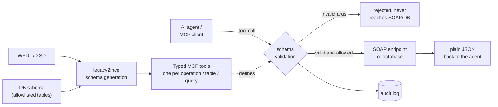

# How legacy2mcp works

What happens between your legacy system and an MCP client, what each adapter covers, and where legacy2mcp fits.

## How it works

**SOAP:**
1. Loads the WSDL with [`zeep`](https://docs.python-zeep.org/), a mature, widely-used Python SOAP client.
2. For every operation on every port/binding, converts the XSD input type into a JSON Schema ([`schema/xsd_to_jsonschema.py`](../src/legacy2mcp/schema/xsd_to_jsonschema.py)) — simple types, nested complex types, enums and arrays, recursively, depth-limited for pathological WSDLs.
3. Registers one MCP tool per operation, named `<adapter_id>_<OperationName>`.
4. On a tool call: validates arguments with `jsonschema` (schemas use `additionalProperties: false`), calls the operation via `zeep`, serializes the response to plain JSON, and writes an audit entry.

**DB:**
1. Connects with the dialect's driver (`psycopg` / `pyodbc` / `oracledb`, imported lazily) and introspects the live column types for each allowlisted table ([`adapters/db_dialects.py`](../src/legacy2mcp/adapters/db_dialects.py)) into JSON Schema ([`schema/sql_to_jsonschema.py`](../src/legacy2mcp/schema/sql_to_jsonschema.py)).
2. Registers `select_<table>` / `insert_<table>` per allowlisted table-and-operation, plus `query_<name>` per named query in config.
3. On a tool call: validates arguments, builds SQL from the allowlisted table/columns (or runs the config-supplied named query) using one dialect-neutral `:param` placeholder convention, executes it, and writes an audit entry. The LLM never sees or writes SQL text.
4. Operations whose names look like writes are excluded unless `allow_write_operations: true`.

**REST:**
1. There's no live schema to introspect a plain REST API from the way there is a WSDL or a DB catalog, so the endpoint list (method, path, typed params) comes from config -- hand-written, or generated by `legacy2mcp init`'s OpenAPI/Swagger discovery or source-code scan.
2. Registers one MCP tool per allowlisted endpoint, named `<adapter_id>_<name>`.
3. On a tool call: validates arguments, splits them into path/query/body by each param's declared `location`, substitutes `{param}` placeholders into the URL, and calls it with `requests` -- auth applied per the adapter's `auth` config (basic/bearer/none).
4. Endpoints marked `write: true` are excluded unless `allow_write_operations: true`. `legacy2mcp init` sets that flag by default on non-`GET` endpoints and on endpoints whose names look like writes; in a hand-written config, the HTTP method alone does not hide an endpoint.

## Why not just write an adapter by hand?

Because a hand-written adapter is a second copy of your system's schema that
nobody remembers to update. The first time a WSDL operation's signature
shifts or a column changes, your tool's JSON Schema silently drifts from
reality — and an LLM calling it finds out by sending arguments that are
wrong in a way nothing catches, or by getting a confusing runtime error from
deep inside the SOAP/DB client. legacy2mcp builds the schema from the live
system every time it starts, so a drifted call fails at validation, before
it ever reaches your backend — not after.

| | Hand-written adapter (FastMCP / raw SDK) | Generic OpenAPI-to-MCP proxy | legacy2mcp |
|---|---|---|---|
| Schema source | Typed by hand, per tool | The OpenAPI spec, if one exists | The live WSDL / DB schema, or a discovered OpenAPI spec |
| Can drift from the real system | Yes — nothing re-checks it | Only if the spec itself is stale | No — rebuilt from the live source at startup |
| Covers SOAP / a database | You write that client code yourself | No — REST/OpenAPI only | Yes, plus REST and plain websites |
| Write operations hidden by default | No — you remember to gate each one | No — usually exposes everything the spec defines | Yes — explicit `allow_write_operations` opt-in |
| Audit log of every call | DIY | Usually no | Built in |
| Time to a working server | Hours to days, per system | Minutes, for a REST API with a spec | Minutes — `legacy2mcp init` |

## What's handled

| Area | Covered |
|---|---|
| **Type mapping** | `string` / `int` / `long` / `decimal` / `boolean` / `date` / `dateTime` / `base64Binary` / … → JSON Schema types + formats |
| **Structure** | nested complex types, repeated elements → arrays, `xsd:enumeration` → `enum`, recursion depth-limited |
| **Discovery** | every service → port → binding → operation; duplicate tool names rejected at startup |
| **Invocation** | argument validation, `zeep` call, response serialized to plain JSON, single-field responses re-wrapped to a named result |
| **Errors** | SOAP faults and transport errors caught and returned as clean messages — no stack traces to the caller |
| **Auth** | HTTP basic (username + `*_env` password); bearer token (`*_env`); anonymous |
| **Transport** | `stdio` (the transport Claude Desktop and most agent frameworks spawn) |
| **DB dialects** | Postgres, SQL Server, Oracle — table allowlist (`select`/`insert`) with live schema introspection, plus named parameterized queries |
| **REST** | explicit endpoint allowlist (method + path + typed params) from config or `legacy2mcp init` — no live schema to introspect, so nothing here is verified until you run it |
| **Discover sources** | Postman collections, local OpenAPI/Swagger files, a live DB's stored-procedure catalog, HAR traffic captures, declarative queue descriptions, and websites (`--webpage-url`, crawled for forms/content) → a reviewable `contract.yaml` (confidence, enums, error codes) → `legacy2mcp init --from-contract` or straight into `init --webpage-url`/`demo` |
| **`describe_capabilities`** | every generated server exposes this meta-tool for free — an agent can ask what the server can do before calling anything |
| **Try it + connect** | `init`/`discover`/`demo` all auto-open a no-API-key test-chat page and print a ready-to-paste connection snippet for Claude Desktop, Cursor, VS Code, and Claude Code |

See [docs/security.md](security.md) for the full, honest security model — what's covered today and what isn't yet.

## Use cases

| Domain | Shape |
|---|---|
| **Systems of record** | An agent reads status/detail records from a legacy back-office platform, read-only, every lookup logged. |
| **Financial services** | Expose account and transaction *reads* without exposing transfers or adjustments. |
| **Supply chain / ERP** | Surface order status, inventory, shipment tracking from an old SOAP middleware layer. |
| **Internal support tooling** | A support copilot gets safe, typed access to the system of record instead of a scraped UI. |
| **Migration & modernization** | Put an MCP layer in front of a legacy service now; swap the backend later without touching the agent. |
